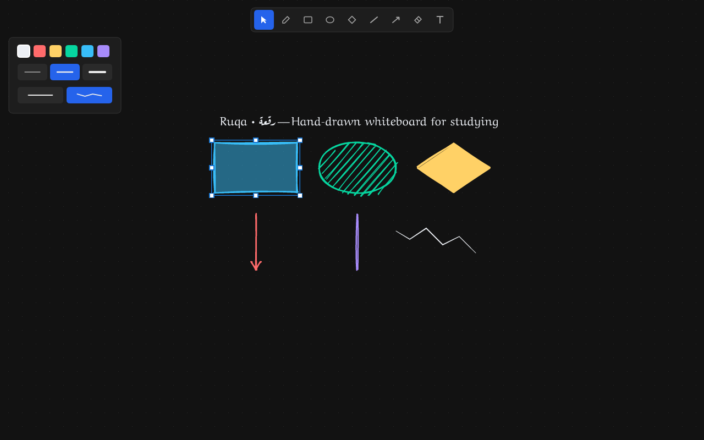

# Ruqa

> [!NOTE]
> **Status: v0.1.0 MVP Release Candidate**  
> Ruqa is a lightweight, open-source desktop whiteboard built in Rust. All core MVP drawing tools, infinite canvas, direct manipulation, persistence, dark theme, and high-resolution PNG export are fully functional.

[](https://github.com/ofuqq/ruqa/actions/workflows/ci.yml)
[](LICENSE)

[User Guide](docs/user-guide.md) | [Architecture](docs/README.md) | [Developer Setup](docs/development/setup.md) | [Manual Test Checklist](docs/development/manual-test-checklist.md) | [Roadmap](docs/roadmap.md) | [Contributing](CONTRIBUTING.md)

---

<p align="center">
  
</p>

**Ruqa** (named after Ruq'ah, the swift, clean Arabic handwriting style) is a lightweight, open-source desktop whiteboard and study scratchpad built in Rust by [Ofuq](https://github.com/ofuqq).

Inspired by tools like Excalidraw, Ruqa is engineered from scratch for **studying, teaching, and visual explaining**. It delivers an aesthetic hand-drawn sketch look, buttery-smooth pen ink, an infinite zoomable canvas, bilingual Arabic/Latin typography, a default dark theme, and complete offline privacy—operable entirely with a standard mouse.

---

## Why Ruqa? (Native Mouse-First vs. Web Tools)

Most digital whiteboards run inside Electron or heavy web browsers, requiring cloud accounts and treating mouse users as secondary to stylus tablets. Ruqa is built differently:

| Feature | Ruqa (Desktop Native) | Browser Alternatives (Excalidraw web, Miro, etc.) |
|:---|:---|:---|
| **Engine & Stack** | Native Rust (`winit` + pure CPU `tiny-skia` + `softbuffer`) | JavaScript / WebGL / Chromium / Electron |
| **Startup Behavior** | Fast native execution (compiled Rust binary without browser runtime boot latency) | Web bundle download, asset loading, and browser initialization |
| **Memory Footprint** | **~34.2 MB** peak RSS measured in continuous 125-op study simulation (`dogfooding_session_tests`) | Browser tab and background helper processes |
| **Offline Privacy** | **100% Offline** · Zero telemetry · Local `.ruqa` JSON | Cloud accounts, sync servers, or fragile browser storage |
| **Input Philosophy** | **Mouse-First**: velocity pen, wheel zoom, single-key tools | Stylus/touch-first priority |
| **Rendering** | Deterministic rough shapes with stable PRNG seeds; redraw-on-demand (0 frames while idle) | Dynamic re-jittering and continuous animation loops |
| **Study Vault** | Native local folder browser sidebar (`Ctrl+B`) | Manual file uploads or cloud workspace lock-in |

---

## Core Features (v0.1.0 MVP)

- [x] **Infinite Vector Canvas**: Smooth 60+ FPS panning (`Space`+drag or middle-click) and mouse-wheel zooming anchored at cursor.
- [x] **Geometric Shapes**: Hand-drawn sketchy rectangles, ellipses, diamonds, straight lines, and directional arrows.
- [x] **Smooth Freehand Pen**: Velocity-interpolated ink strokes with Catmull-Rom spline smoothing.
- [x] **Bilingual Typography**: Mixed Arabic and Latin text layout powered by `parley` and `skrifa` with bundled OFL fonts.
- [x] **Direct Manipulation**: Click & marquee multi-selection, drag translation, and 8-handle corner/edge interactive resizing.
- [x] **Continuous Eraser**: Drag across shapes or ink paths to erase continuously in a single atomic undoable action.
- [x] **Contextual Styling**: 6-color dark palette, thin/medium/bold stroke widths, and 5 fill patterns (None, Solid, Semi-transparent, Hachure, Cross-hatch).
- [x] **Theme Inversion**: High-contrast dark theme by default (`#121212`), with instant `Ctrl+T` / `Ctrl+I` toggle preserving accent colors.
- [x] **Document Persistence**: Versioned, forward-compatible `.ruqa` JSON format with atomic crash-safe autosave.
- [x] **Unsaved Changes Guard**: Headless modal dialog preventing accidental data loss on close or quit.
- [x] **High-Resolution PNG Export**: Crisp 2x HiDPI snapshot export supporting tight selection crop vs full diagram.
- [x] **Study Organization**: Startup Recent Files HUD and local Study Vault directory sidebar (`Ctrl+B`).
- [x] **Redraw-on-Demand**: Strict event-driven presentation (`ControlFlow::Wait`) presenting 0 frames while idle.

See [docs/user-guide.md](docs/user-guide.md) for the complete controls and keyboard shortcut cheatsheet.

---

## Quickstart & Build Instructions

### Prerequisites
- Rust stable (1.80+ recommended). Install via [rustup](https://rustup.rs):
  ```bash
  curl --proto '=https' --tlsv1.2 -sSf https://sh.rustup.rs | sh
  ```

For detailed platform dependencies (e.g. `libxkbcommon` on Linux), see **[docs/development/setup.md](docs/development/setup.md)**.

### Building & Running
```bash
# Clone the repository
git clone https://github.com/ofuqq/ruqa.git
cd ruqa

# Run all quality verification gates
cargo fmt --all --check
cargo clippy --workspace --all-targets -- -D warnings
cargo test --workspace
cargo deny check licenses bans sources

# Launch the desktop application
cargo run --release -p ruqa-app
```

> [!NOTE]
> Ruqa is verified across native desktop windowed execution (`cargo run --release -p ruqa-app`) and an end-to-end headless application harness (`crates/ruqa-app/tests/e2e_app_harness_tests.rs`) validating mouse routing, interactive drawing, dialogs, and rendered pixel geometry.

---

## Project Structure

```text
ruqa/
├── crates/
│   ├── ruqa-core/         # Core geometry, element models, undo stack, and file I/O
│   ├── ruqa-render/       # 2D rendering pipeline (tiny-skia CPU, roughr, softbuffer, parley)
│   └── ruqa-app/          # Native OS windowing (winit), input dispatch, and UI chrome
├── docs/                  # Architectural specs, product vision, ADRs, and guides
│   ├── adr/               # Architecture Decision Records (0001–0009)
│   ├── architecture/      # Detailed design documents
│   ├── business/          # Open-source sustainability and decision logs
│   ├── development/       # Contributor setup and AI agent workflow
│   ├── product/           # Vision, principles, competitive analysis, and kill gates
│   └── research/          # Market research digest and crate audits
├── .github/               # CI workflows, issue templates, PR template, rulesets
├── LICENSE                # Apache License, Version 2.0
├── NOTICE                 # Attribution and copyright notice
├── deny.toml              # Cargo-deny license and ban policy
└── README.md
```

---

## Documentation & Architecture

- **[Product Vision & Principles](docs/product/vision.md)**: Why Ruqa exists and the principles guiding its development.
- **[MVP Scope & Non-Goals](docs/product/mvp.md)**: Explicit scope boundaries for the v0.1 release.
- **[Kill Criteria & Gates](docs/product/kill-criteria.md)**: Empirical go/no-go gates for technical spikes and dogfooding.
- **[Architectural Overview](docs/architecture/overview.md)**: Modular design separating math/core, rendering, and windowing.
- **[Architecture Decision Records (ADRs)](docs/adr/README.md)**: Index of architectural choices from language to contingency fallbacks.

---

## Contributing

We welcome community feedback, code contributions, and discussions. Please read our [Contributing Guide](CONTRIBUTING.md) and [Code of Conduct](CODE_OF_CONDUCT.md) before submitting pull requests.

---

## License

Ruqa is open source licensed under the **Apache License, Version 2.0**.  
See the [LICENSE](LICENSE) file and [NOTICE](NOTICE) for details.
