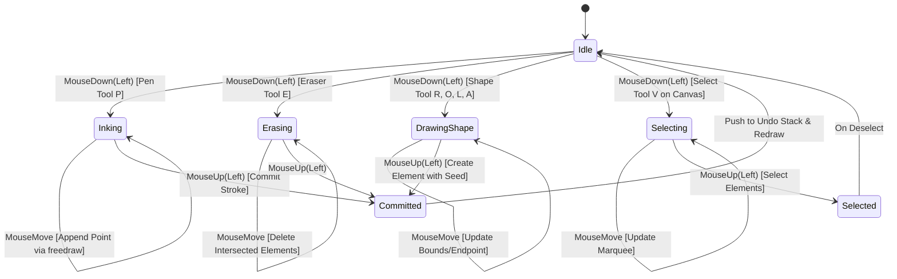

# Input Handling & Tool State Machines

> **Status: Design Proposal (Draft)**  
> This document specifies mouse and keyboard event handling, coordinate mapping, and tool interaction state machines for Mirsam.

---

## 1. Mouse & Keyboard Interaction Matrix

Mirsam is built to be fast and fluid with a standard two-button mouse with scroll wheel and keyboard:

| Input Gesture | Context | Result |
| :--- | :--- | :--- |
| **Left Click & Drag** | Pen tool (`P`) | Draw continuous velocity-smoothed freehand stroke |
| **Left Click & Drag** | Eraser tool (`E`) | Erase intersected strokes / elements |
| **Left Click & Drag** | Shape tool (`R`, `O`, `L`, `A`) | Draw geometric shape from origin to cursor |
| **Left Click & Drag** | Select tool (`V`) on canvas | Drag multi-element selection bounding box |
| **Left Click & Drag** | Select tool (`V`) on element | Translate selected element(s) |
| **Double Click** | Canvas or Shape | Activate on-canvas text editing |
| **Middle Click & Drag** | Any tool | Pan canvas view smoothly |
| **Space + Left Click Drag** | Any tool | Pan canvas view smoothly |
| **Mouse Wheel Scroll** | Any tool | Zoom in / out centered on cursor position |
| **Ctrl + Z** | Any tool | Undo last action |
| **Ctrl + Y / Ctrl+Shift+Z** | Any tool | Redo last action |
| **Ctrl + S** | Any tool | Save board atomically to disk |
| **Ctrl + B** | Any tool | Toggle Study Vault folder sidebar |
| **Ctrl + E** | Any tool | Export canvas to PNG image |

---

## 2. Tool State Machine

---

## 3. Velocity-Based Stroke Smoothing (`freedraw`)

Raw mouse input produces discrete steps (~60–125 Hz). Mirsam uses the pure-Rust port of Steve Ruiz's `perfect-freehand` algorithm (`freedraw` crate or local module):
1. **Dynamic Pressure Simulation**: Calculates instantaneous mouse speed between successive points ($v = \Delta d / \Delta t$).
2. **Tapering**: High speed thins the stroke; slow deliberate movement widens it.
3. **Polygon Contour Generation**: Generates an outer polygon outline rendered with anti-aliasing in `tiny-skia`.
