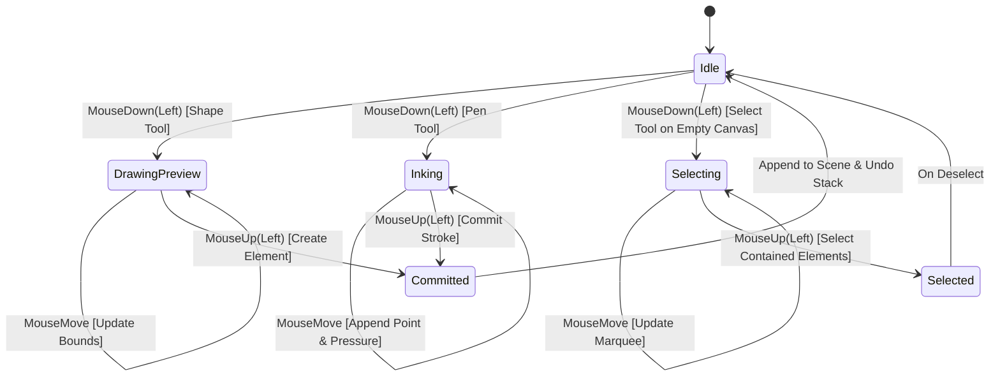

# Input Handling & Tool State Machines

> **Status: Design Proposal (Draft)**  
> This document specifies mouse and keyboard event handling, coordinate mapping, and tool interaction state machines.

---

## 1. Mouse Interaction Matrix

Lawh is designed to be fully operable using a standard two-button mouse with a scroll wheel:

| User Action | Context | Result |
| :--- | :--- | :--- |
| **Left Click & Drag** | Pen tool active | Draw continuous smoothed freehand stroke |
| **Left Click & Drag** | Shape tool active | Draw shape from origin to cursor |
| **Left Click & Drag** | Select tool on canvas | Drag multi-element selection rectangle |
| **Left Click & Drag** | Select tool on element | Translate selected element(s) |
| **Middle Click & Drag** | Any tool active | Pan canvas view smoothly |
| **Space + Left Click Drag** | Any tool active | Pan canvas view smoothly |
| **Mouse Wheel Scroll** | Any tool active | Zoom in / out centered on cursor position |
| **Right Click** | Element | Contextual properties (Color, Width, Delete) |

---

## 2. Tool State Machine

The interaction engine operates as a state machine where the active tool receives translated world coordinates:

---

## 3. Stroke Smoothing Algorithm

Raw mouse events arrive as discrete $(x, y)$ points at ~60–125 Hz. Without smoothing, drawing circles or curves with a mouse produces jagged, stair-stepped lines.

1. **Velocity Calculation**: Calculate instantaneous distance and time between successive pointer events:
   $$v = \frac{\Delta d}{\Delta t}$$
2. **Width Modulation**: Fast strokes thin slightly; slow deliberate strokes widen, simulating natural ink pressure.
3. **Catmull-Rom or Bezier Fitting**: Intermediate points are smoothed using a sliding window spline before committing vector contours to the scene graph.
