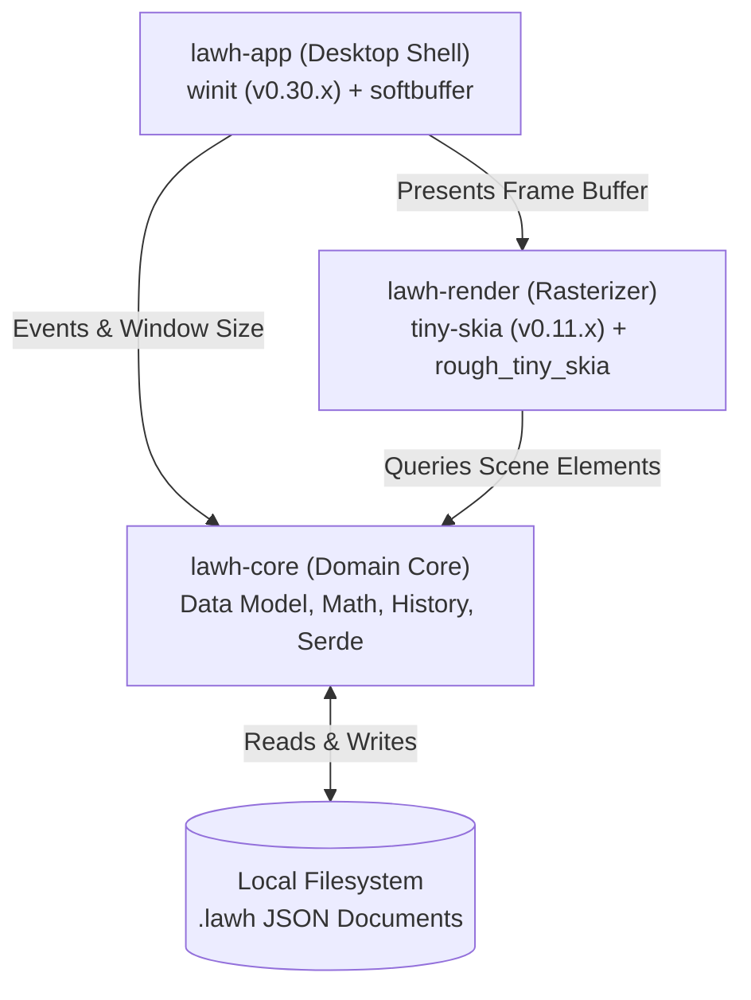

# Architecture Overview

> **Status: Design Proposal (Draft)**  
> This document describes the planned multi-crate modular architecture for Lawh.

---

## 1. Architectural Philosophy

Lawh follows three architectural rules:
1. **Separation of Concerns**: Core data structures and canvas math must never know about OS windows, event loops, or graphic rasterizers.
2. **Deterministic State**: Canvas state is a pure, immutable-friendly data structure that can be serialized, cloned, and tested headlessly.
3. **Thin Layering**: Avoid speculative abstractions, generic rendering wrappers, or plugin systems until concrete needs emerge.

---

## 2. Crate Responsibilities

### `crates/lawh-core` (Domain Foundation)
- **Zero OS or Graphics Dependencies**: Compiles purely to standard Rust without linking to X11, Wayland, or graphics drivers.
- **Canvas Geometry**: 2D points (`Point2D`), bounding boxes (`Rect`), affine transforms (translation, scale, viewport mapping).
- **Scene Graph**: Collection of ordered canvas elements (`Element` enum).
- **History System**: Command-based Undo/Redo stack storing reversible delta operations.
- **Document Serialization**: Serde implementation for the `.lawh` (v1) JSON document format.

### `crates/lawh-render` (Planned for M2)
- **Role**: Software rasterization engine.
- **Dependencies**: `tiny-skia` (v0.11), `rough_tiny_skia` (v0.14), `roughr` (v0.14).
- **Functionality**:
  - Takes a slice of `&Element` and the current `Viewport` transform.
  - Draws jittered rough geometry and smooth strokes into an in-memory `tiny_skia::PixmapMut`.
  - Handles off-screen clipping to avoid rendering shapes outside the visible viewport.

### `crates/lawh-app` (Planned for M1)
- **Role**: Desktop application runtime and window coordinator.
- **Dependencies**: `winit` (0.30.x), `softbuffer` (0.4.x).
- **Functionality**:
  - Initializes OS window and event loop.
  - Manages the active tool state machine (Selection, Pen, Rectangle, etc.).
  - Blits the `tiny-skia` pixel buffer to the OS window via `softbuffer`.
  - Dispatches keyboard shortcuts (`Ctrl+Z`, `Ctrl+S`, `Delete`).

---

## 3. Data Flow During an Event Cycle

1. **User Interaction**: User drags mouse on canvas.
2. **OS Event**: `winit` emits `WindowEvent::CursorMoved`.
3. **Tool Dispatch**: The active tool state machine in `lawh-app` maps the screen coordinate $(x, y)$ to canvas world coordinates using the current `Viewport` zoom/pan matrix.
4. **Scene Mutation**: If drawing, a temporary preview element is added to the active frame state.
5. **Render Pass**:
   - `lawh-render` clears the background buffer with the dark-theme color (`#121212`).
   - Elements intersecting the current viewport are rasterized into the pixel buffer.
6. **Presentation**: `softbuffer` copies the 32-bit RGBA pixel slice to the window surface.
