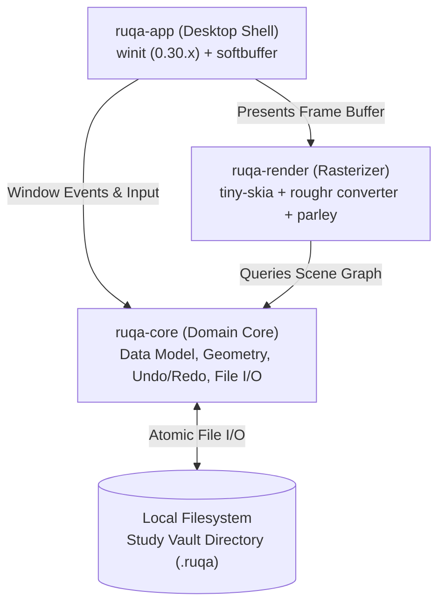

# Architecture Overview

> **Status: Design Proposal (Draft)**  
> This document describes the 3-crate modular architecture for Ruqa.

---

## 1. Architectural Philosophy

Ruqa adheres to three strict architectural rules:
1. **Clean 3-Crate Decomposition**: Domain core (`ruqa-core`) has zero UI, OS, or GPU dependencies. Rendering is isolated in `ruqa-render`. Windowing and input live in `ruqa-app`.
2. **Clean-Room Guarantee**: Zero code copied or translated from AGPL/GPL projects (drafft-ink, Rnote, Xournal++). All implementations are greenfield or use explicitly vetted Apache/MIT dependencies.
3. **Contingency-Ready**: If the native Rust rendering stack fails the Day-14 Gate, the architecture cleanly pivots to a Tauri v2 hybrid where `ruqa-core` remains the backend (see [ADR 0006](../adr/0006-contingency-tauri-fallback.md)).

---

## 2. Crate Responsibilities

### `crates/ruqa-core` (Domain Foundation)
- **Zero OS / Graphics Dependencies**: Compiles as a pure Rust library. Can be tested 100% headlessly on any platform.
- **Canvas Math & Geometry**: Points, bounding rectangles (AABB), coordinate transformations (Screen $\leftrightarrow$ World).
- **Scene Graph**: Ordered collection of canvas elements with deterministic seeds.
- **Command-Pattern Undo / Redo**: Reversible operations stack.
- **Study Vault & Persistence**: Atomic serialization and deserialization of `.ruqa` JSON documents.

### `crates/ruqa-render` (Rasterization & Typography Engine)
- **Dependencies**: `tiny-skia`, `roughr` (core only, no adapter crates), `parley`, `fontique`.
- **Functionality**:
  - Local converter function mapping `roughr::core::OpSet` directly to `tiny_skia::PathBuilder`.
  - Velocity-tapered freehand stroke polygon generation (via `freedraw` algorithm).
  - Parley text layout engine with bundled Arabic and Latin fonts.
  - Software rasterization into an in-memory `tiny_skia::PixmapMut`.
  - **Rule**: Do NOT add spatial tile caching or `rayon` multi-threading until the 5k-element benchmark proves it is necessary.

### `crates/ruqa-app` (Desktop Shell & Event Loop)
- **Dependencies**: `winit` (0.30.x), `softbuffer` (0.4.x).
- **Functionality**:
  - Initializes OS desktop window and runs the event loop.
  - Translates pointer events into canvas world coordinates.
  - Dispatches tool state machine actions (Pen, Eraser, Rectangle, Ellipse, Line, Arrow, Select).
  - Blits the rendered CPU pixmap to the window surface via `softbuffer`.
  - Manages the collapsible Study Vault folder sidebar.
