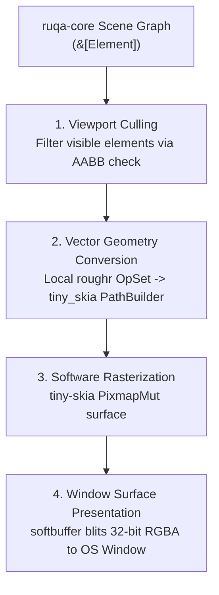

# Rendering Architecture

> **Status: Design Proposal (Draft)**  
> This document details the CPU-first software rasterization pipeline, the `roughr` local converter, and window presentation.

---

## 1. Pipeline Overview

Ruqa employs a clean CPU-first software rendering pipeline:



---

## 2. Why CPU-First with `tiny-skia`?

1. **Zero GPU Driver Variance**: Eliminates driver crashes, Vulkan/Metal/DirectX initialization errors, and Wayland swapchain bugs.
2. **Deterministic Output**: CPU rasterization renders identically on all Linux distributions, Windows, and headless CI runners.
3. **Sub-100 MB RAM Footprint**: Bypasses the heavy baseline RAM overhead of GPU swapchains (e.g. wgpu).

---

## 3. The `roughr` Local Converter (No Adapter Crates)

To prevent crate version conflicts (such as `rough_tiny_skia 0.14` pinning `tiny-skia = "0.11"` against newer releases), `ruqa-render` depends **only on `roughr` core** (`roughr = "0.14"`).

A lightweight internal converter function (~35 LOC) maps `roughr::core::OpSet` directly into `tiny_skia::PathBuilder`:

```rust
use roughr::core::{Op, OpSet};
use tiny_skia::{Path, PathBuilder};

pub fn opset_to_path(op_set: &OpSet) -> Option<Path> {
    let mut pb = PathBuilder::new();
    for op in &op_set.ops {
        match *op {
            Op::Move(pt) => pb.move_to(pt.x as f32, pt.y as f32),
            Op::LineTo(pt) => pb.line_to(pt.x as f32, pt.y as f32),
            Op::BezierCurveTo(c1, c2, pt) => {
                pb.cubic_to(c1.x as f32, c1.y as f32, c2.x as f32, c2.y as f32, pt.x as f32, pt.y as f32);
            }
        }
    }
    pb.finish()
}
```

---

## 4. Rule on Spatial Tile Caching & Multithreading

> **Architectural Rule**: Do NOT implement 256px spatial tile caching or multi-threaded `rayon` workers until the benchmark harness in Spike 1 proves that single-threaded `tiny-skia` fails to maintain 60 FPS ($< 16.6\text{ ms}$) on a 5,000-element scene.

Prematurely introducing a tile cache adds dirty-rectangle tracking, invalidation bugs, and thread synchronization overhead. We keep the pipeline single-threaded and direct until data demands optimization.

---

## 5. Window Presentation via `softbuffer`

1. `winit` (0.30.x) creates the OS window and handles input events.
2. `softbuffer::Surface` binds to the native window handle.
3. On redraw, `tiny-skia` draws into an in-memory `Pixmap`.
4. Pixels are copied directly into `surface.buffer_mut()`, and `buffer.present()` presents the frame to the display.
