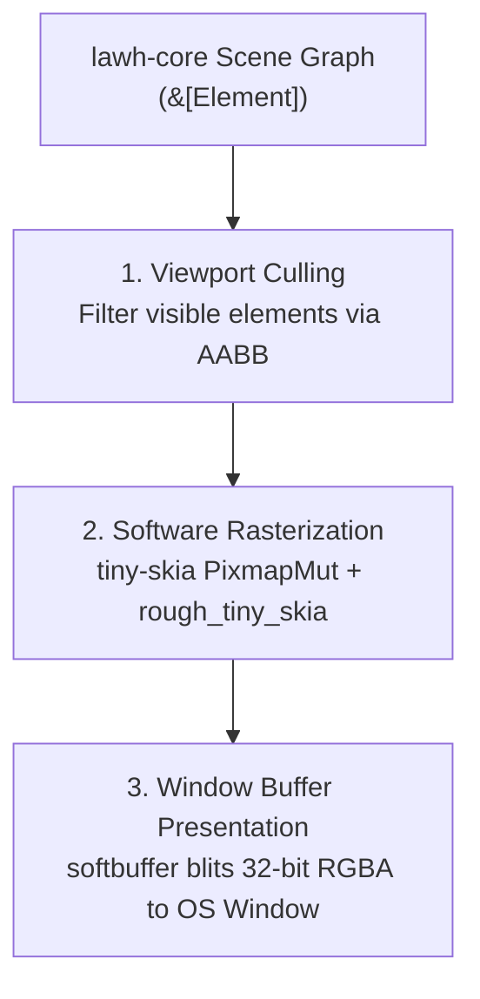

# Rendering Architecture

> **Status: Design Proposal (Draft)**  
> This document details the 2D software rendering pipeline, rough shape generation, and frame presentation.

---

## 1. Pipeline Overview

Lawh adopts a CPU-first software rendering pipeline for v0.1:



### Why CPU-First for v0.1?
- **Zero GPU Driver Pitfalls**: Software rasterization runs uniformly across all Linux distributions (X11 and Wayland) and CI test environments without requiring Vulkan, OpenGL, or proprietary GPU drivers.
- **Predictable Performance**: `tiny-skia` is an optimized pure-Rust port of Skia's 2D software rasterizer with SIMD acceleration (SSE, AVX, NEON).
- **Simplicity**: No complex WebGPU pipeline initialization, shader compilation, or swapchain synchronization.

---

## 2. Rough Shape Rasterization

Hand-drawn shapes are rendered using `rough_tiny_skia` (v0.14) and `roughr` (v0.14):
1. **Contour Jitter**: The algorithm calculates slight offsets along line segments, drawing double strokes with controlled curvature.
2. **Deterministic Seed**: The `style.seed` is passed into the generator, ensuring identical stroke paths between frames.
3. **Paths to Pixmap**: The resulting vector paths are drawn directly into a `tiny_skia::PixmapMut` surface with anti-aliasing enabled.

---

## 3. Window Buffer Presentation (`softbuffer`)

How pixels reach the display:
1. `winit` (0.30.x) provides the desktop window handle.
2. `softbuffer::Context` binds to the display server (X11 / Wayland / Win32 / Cocoa).
3. `softbuffer::Surface` creates a presentation buffer matching the window's physical pixel width and height.
4. `tiny-skia` renders into an RGBA byte slice:
   ```rust
   let mut buffer = surface.buffer_mut()?;
   // Copy tiny_skia pixmap pixels into softbuffer slice
   for (dst, src) in buffer.iter_mut().zip(pixmap.data()) {
       *dst = pack_rgba_to_u32(src);
   }
   buffer.present()?;
   ```

---

## 4. Viewport Culling & Optimization

To maintain 60 FPS even on large infinite boards:
- **Axis-Aligned Bounding Box (AABB) Culling**: Before rasterizing an element, its bounding box is checked against the visible screen viewport in world coordinates.
- **Offscreen Skip**: Elements completely outside the viewport are rejected before calculating rough paths.
- **Benchmark Gate**: An automated benchmark measuring 1k, 5k, and 10k strokes will govern whether and when Lawh transitions to GPU compute rendering (`vello`).
