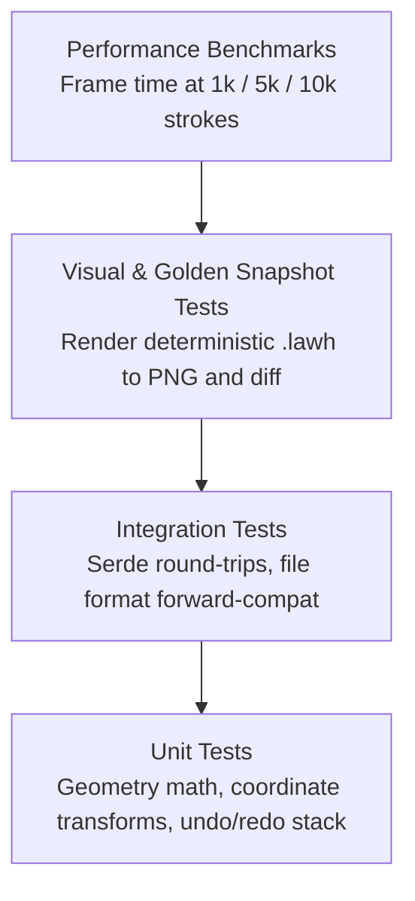

# Testing Strategy

> **Status: Design Proposal (Draft)**  
> This document defines the automated testing layers, regression verification, and performance benchmarks for Lawh.

---

## 1. Testing Pyramid

---

## 2. Test Layers

### 1. Unit Tests (Fast, Headless)
- Located in `crates/lawh-core/src/` alongside code in `#[cfg(test)] mod tests`.
- **Scope**:
  - `Point`, `Rect`, and `Viewport` coordinate conversion math.
  - AABB intersection tests (selection hit-testing and viewport culling).
  - Undo and Redo command reversal logic.
  - Zero dependencies on graphics hardware or OS windows.

### 2. Integration Tests (`tests/`)
- Located in `crates/lawh-core/tests/`.
- **Scope**:
  - End-to-end document serialization and deserialization.
  - Forward-compatibility tests: opening a mocked v2 document in a v1 reader to ensure unrecognized properties are safely ignored without crashing.
  - Corrupted document recovery: ensuring partially corrupted JSON yields valid remaining shapes.

### 3. Visual Golden Tests (Headless Rasterization)
- Because `tiny-skia` is a software rasterizer, it renders identically on any CPU architecture without GPU driver variance.
- Test runner renders canonical sample boards (e.g., `samples/geometric-primitives.lawh`) into an in-memory pixmap.
- Pixel diff against golden PNG files catches unintentional rendering regressions.

### 4. Rendering Performance Benchmarks (Decision 7)
- Automated Criterion / harness benchmarks measuring milliseconds per frame:
  - **1,000 synthetic strokes**: Target $< 16.6\text{ ms}$ (sustained 60 FPS on standard modern CPU).
  - **5,000 synthetic strokes**: Target $< 50\text{ ms}$.
  - **10,000 synthetic strokes**: Stress evaluation point for GPU (`vello`) transition planning.
- Run locally and on dedicated CI runs to detect throughput regressions.
