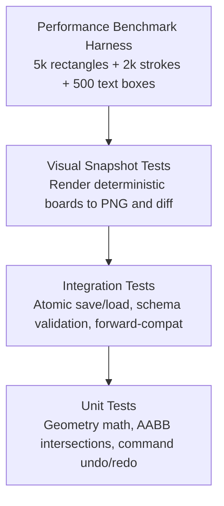

# Testing & Benchmarking Strategy

> **Status: Design Proposal (Draft)**  
> This document defines automated testing layers, visual regression suites, and the performance benchmark harness for Mirsam.

---

## 1. Testing Pyramid

---

## 2. Test Layers

### 1. Unit Tests (`crates/mirsam-core/src/`)
- Fast, 100% headless tests compiled alongside modules.
- **Coverage**:
  - `Point`, `Rect`, and `Viewport` coordinate conversion math.
  - AABB intersection tests (`Rect::intersects`).
  - Command undo/redo state mutations and depth clamping.

### 2. Integration Tests (`crates/mirsam-core/tests/`)
- Tests document persistence and serialization resilience.
- **Coverage**:
  - Round-trip serialization and deserialization of `.mirsam` JSON documents.
  - Atomic file write safety: confirming `.tmp` file is safely renamed.
  - Forward-compatibility tests: opening mocked future schema versions with extra keys without errors.

### 3. Visual & Rasterization Snapshots (`crates/mirsam-render/tests/`)
- Renders deterministic test fixtures into in-memory `tiny-skia` pixmaps.
- Compares output against golden reference PNG images to catch unintentional visual rendering regressions across Linux distributions.

---

## 3. Performance Benchmark Harness (Spike 1 Specification)

To validate the CPU software rasterizer against data before building UI features, a benchmark harness tests performance on a heavy synthetic study board:

### Benchmark Scene (Resolution: $2560 \times 1440$)
- **5,000** `roughr` geometric rectangles
- **2,000** `freedraw` 200-point freehand strokes
- **500** mixed Arabic/English `parley` text boxes

### Target Metrics (Performance Hypotheses)
1. **Cold Viewport Rasterization**: Time to render full 1440p frame during continuous zoom (Target: $< 16.6\text{ ms}$, sustaining 60 FPS).
2. **Viewport Pan Frame Time**: Blitting frame buffer during continuous middle-click pan (Target: $< 16.6\text{ ms}$).
3. **Single-Node Drag Frame Time**: Redrawing dirty region while translating one selected node (Target: $< 10.0\text{ ms}$).
4. **Idle Process Memory (RSS)**: Total process resident memory under full load (Target: $< 100\text{ MB}$).

If single-threaded `tiny-skia` satisfies these targets, we avoid adding tile caching or multi-threading. If it fails, Spike 1 evaluates `vello_cpu` or a 256px tile cache.
