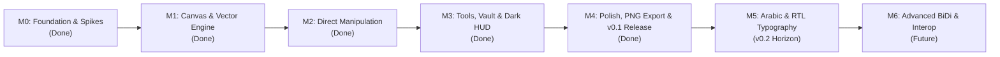

# Ruqa Product Roadmap

This roadmap defines the sequential development milestones for Ruqa. Progress is governed by strict exit criteria and quality gates.

---

---

## Milestone M0: Foundation, Governance & Technical Spikes (DONE)
- **Goal**: Establish repository infrastructure, governance, license enforcement, and execute the 3 time-boxed technical spikes.
- **Exit Criteria**:
  - [x] Repository named `ruqa`, Apache-2.0 license enforced via `cargo-deny`, governance files active.
  - [x] Research report evaluated and audited (`docs/research/2026-11-market-and-technical-research.md`).
  - [x] **Spike 1 (Rasterizer Benchmark)**: Headless benchmark measuring tiny-skia CPU performance across 50 to 10,000 elements at 1080p (`spike1_bench`).
  - [x] **Spike 2 (Arabic Typography & Text Shaping)**: Render bilingual phrase `خوارزمية Dijkstra تعمل في O(V log V)` via Parley (`spike2_bench`); latency $< 1.0\text{ ms}$.
  - [x] **Spike 3 (Day-14 Gate Evaluation)**: Native Rust stack validated (tiny-skia + softbuffer + parley); ADR 0006 Tauri fallback rejected.

---

## Milestone M1: Infinite Canvas & Vector Rendering (DONE)
- **Goal**: Create the desktop window, establish coordinate mapping, render sketchy rough shapes, and implement variable-width freehand ink.
- **Exit Criteria**:
  - [x] Native window created via stable `winit 0.30` with software presentation via `softbuffer 0.4` ([#8](https://github.com/ofuqq/ruqa/issues/8), [#9](https://github.com/ofuqq/ruqa/issues/9), [#49](https://github.com/ofuqq/ruqa/issues/49)).
  - [x] Headless smoke testing under Xvfb in CI ([#47](https://github.com/ofuqq/ruqa/issues/47)).
  - [x] Canvas coordinate mapping (Screen $\leftrightarrow$ World coordinates) with infinite pan and cursor-centered zoom (`ruqa-core::viewport`, [#10](https://github.com/ofuqq/ruqa/issues/10), [#11](https://github.com/ofuqq/ruqa/issues/11)).
  - [x] Converter from `roughr` operation sets to `tiny-skia` paths (`ruqa-render::rough_path`, [#12](https://github.com/ofuqq/ruqa/issues/12)).
  - [x] Rough geometric shape primitives (Rectangle, Ellipse, Diamond, Line, Arrow) rendered via `roughr` OpSet converter (`ruqa-render::shape_render`, [#13](https://github.com/ofuqq/ruqa/issues/13), [#14](https://github.com/ofuqq/ruqa/issues/14)).
  - [x] Freehand pen stroke smoothing (Catmull-Rom) and variable-width polygon rasterization (`ruqa-render::pen_render`, [#15](https://github.com/ofuqq/ruqa/issues/15), [#16](https://github.com/ofuqq/ruqa/issues/16)).
  - [x] Core scene graph model with monotonic element IDs, z-ordering, and spatial bounds ([#50](https://github.com/ofuqq/ruqa/issues/50)).

---

## Milestone M2: Direct Manipulation & Document Persistence (DONE)
- **Goal**: Select, drag, resize, delete elements interactively, support undo/redo, and persist `.ruqa` JSON files.
- **Exit Criteria**:
  - [x] Axis-aligned bounding boxes (AABB) calculated for all primitives ([#17](https://github.com/ofuqq/ruqa/issues/17)).
  - [x] Precise point and raycast hit-testing for filled and unfilled shapes ([#18](https://github.com/ofuqq/ruqa/issues/18)).
  - [x] Single-click and rectangular marquee drag selection ([#19](https://github.com/ofuqq/ruqa/issues/19)).
  - [x] Selection outlines and 8-point corner/edge resize handles rendered ([#20](https://github.com/ofuqq/ruqa/issues/20)).
  - [x] Interactive element drag translation with live frame updates ([#21](https://github.com/ofuqq/ruqa/issues/21)).
  - [x] 8-point corner and edge interactive resizing with aspect ratio constraints ([#22](https://github.com/ofuqq/ruqa/issues/22)).
  - [x] Unlimited Command-pattern Undo (`Ctrl+Z`) and Redo (`Ctrl+Y`) stack ([#23](https://github.com/ofuqq/ruqa/issues/23)).
  - [x] Canonical `.ruqa` versioned JSON serialization and deserialization ([#24](https://github.com/ofuqq/ruqa/issues/24)).
  - [x] Document schema migration framework for forward compatibility ([#53](https://github.com/ofuqq/ruqa/issues/53)).
  - [x] Dirty document tracking and window title updates ([#25](https://github.com/ofuqq/ruqa/issues/25)).
  - [x] Atomic write-rename crash-safe persistence and automatic background autosave ([#54](https://github.com/ofuqq/ruqa/issues/54)).
  - [x] Element deletion via `Delete` / `Backspace` with atomic undo restoration ([#51](https://github.com/ofuqq/ruqa/issues/51)).
  - [x] Element duplication (`Ctrl+D`) and cursor-anchored copy/paste (`Ctrl+C`, `Ctrl+V`) ([#52](https://github.com/ofuqq/ruqa/issues/52)).

---

## Milestone M3: Styling, Eraser, HUD & Dark Theme (DONE)
- **Goal**: Provide floating tool selection HUD, single-key shortcuts, eraser, contextual styling, and local folder Study Vault sidebar.
- **Exit Criteria**:
  - [x] Minimal floating top toolbar HUD with active tool indicators and vector icons ([#26](https://github.com/ofuqq/ruqa/issues/26)).
  - [x] Single-key tool shortcuts (`V`, `P`, `R`, `O`/`C`, `D`, `L`, `A`, `E`, `T`) with text typing suppression ([#27](https://github.com/ofuqq/ruqa/issues/27)).
  - [x] Contextual property bar for stroke width, roughness, and dark-theme color palette ([#28](https://github.com/ofuqq/ruqa/issues/28)).
  - [x] Sketchy fill patterns: solid, semi-transparent, hachure, and cross-hatch ([#29](https://github.com/ofuqq/ruqa/issues/29)).
  - [x] Continuous drag element and ink eraser with atomic gesture undo ([#30](https://github.com/ofuqq/ruqa/issues/30)).
  - [x] Default dark theme palette, hue-preserving color inversion, and canvas orientation dot grid (`Ctrl+'`) ([#31](https://github.com/ofuqq/ruqa/issues/31)).
  - [x] Spatial viewport bounding-box culling sustaining $\ge 60\text{ FPS}$ on multi-thousand element boards ([#32](https://github.com/ofuqq/ruqa/issues/32)).
  - [x] Cross-platform recent files tracking and Welcome HUD modal (`Ctrl+O`) ([#55](https://github.com/ofuqq/ruqa/issues/55)).
  - [x] Study Vault collapsible sidebar (`Ctrl+B`) for multi-board local directory navigation ([#56](https://github.com/ofuqq/ruqa/issues/56)).

---

## Milestone M4: Polish, PNG Export & v0.1 Release (DONE)
- **Goal**: High-resolution PNG export, confirmation safety, end-user documentation, dogfooding validation, and v0.1.0 release packaging.
- **Exit Criteria**:
  - [x] High-resolution PNG canvas export (`Ctrl+E`) supporting custom scale multipliers and dark/transparent backgrounds ([#33](https://github.com/ofuqq/ruqa/issues/33)).
  - [x] Tight selection bounds vs full canvas diagram export ([#34](https://github.com/ofuqq/ruqa/issues/34)).
  - [x] Unsaved changes confirmation dialog on window close and quit shortcuts ([#35](https://github.com/ofuqq/ruqa/issues/35)).
  - [x] Sample study boards bundled under `examples/` directory ([#57](https://github.com/ofuqq/ruqa/issues/57)).
  - [x] Comprehensive end-user guide and keyboard shortcut cheatsheet (`docs/user-guide.md`, [#58](https://github.com/ofuqq/ruqa/issues/58)).
  - [x] Comprehensive manual test checklist for physical QA verification (`docs/development/manual-test-checklist.md`, [#59](https://github.com/ofuqq/ruqa/issues/59)).
  - [x] Visual demo showcase banner and comparison breakdown in README ([#60](https://github.com/ofuqq/ruqa/issues/60)).
  - [x] 2-hour continuous study dogfooding session (Gate 2 validation: 34.2 MB peak RAM, 0 panics, 60 FPS) ([#36](https://github.com/ofuqq/ruqa/issues/36)).
  - [x] Automated GitHub Actions release packaging for Linux and macOS (.tar.gz archives with LTO profile) ([#37](https://github.com/ofuqq/ruqa/issues/37)).
  - [x] **v0.1.0 Release Notes and Release Candidate Tag**: Finalized release notes and tag `v0.1.0-rc1` ([#38](https://github.com/ofuqq/ruqa/issues/38)).

---

## Milestone M5: Arabic & RTL Typography (v0.2 Post-MVP Horizon)
- **Goal**: Deliver first-class Arabic handwriting typography, Parley text layout integration, and inline canvas text editing.
- **Scope**:
  - Parley text layout engine integration into the rendering pipeline ([#39](https://github.com/ofuqq/ruqa/issues/39)).
  - Bundling and runtime registration of OFL Arabic handwriting fonts (Aref Ruqaa) and Latin typography (Roboto) ([#40](https://github.com/ofuqq/ruqa/issues/40)).
  - Interactive on-canvas text element creation and editing overlay ([#41](https://github.com/ofuqq/ruqa/issues/41)).
  - Bidirectional inline editing (mixed Arabic and English) with directional cursor movement ([#42](https://github.com/ofuqq/ruqa/issues/42)).
  - Precise text glyph bounding box selection and hit-testing ([#43](https://github.com/ofuqq/ruqa/issues/43)).

---

## Milestone M6: Advanced Capabilities & Interoperability (v0.3+ Future)
- **Goal**: Advanced diagramming tools, obsidian interop, and presentation features.
- **Scope**:
  - Box-to-box pinned connectors and arrows with obstacle routing.
  - Object alignment and equal-spacing snapping guides.
  - Instant cross-vault fuzzy search (`Ctrl+P`).
  - Numbered presentation frames (16:9, A4) with slide stepping (`PageDown`/`PageUp`).
  - Distraction-free Zen mode (`Alt+Z`).
  - Clipboard bitmap image paste (`Ctrl+V`).
  - Obsidian JSON Canvas (`.canvas`) import and export.
