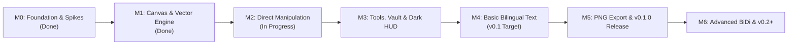

# Ruqa Product Roadmap

This roadmap defines the sequential development milestones for Ruqa. Progress is governed by strict exit criteria and quality gates.

---

---

## Milestone M0: Foundation, Governance & Technical Spikes (DONE)
- **Goal**: Establish the repository infrastructure, governance, license enforcement, and execute the 3 time-boxed technical spikes.
- **Exit Criteria**:
  - [x] Repository renamed to `ruqa`, Apache-2.0 license enforced via `cargo-deny`, governance files active.
  - [x] Research report evaluated and audited (`docs/research/2026-11-market-and-technical-research.md`).
  - [x] **Spike 1 (Rasterizer Benchmark)**: Headless benchmark measuring tiny-skia CPU performance across 50 to 10,000 elements at 1080p (`spike1_bench`).
  - [x] **Spike 2 (Arabic Typography & Text Shaping)**: Render bilingual phrase `خوارزمية Dijkstra تعمل في O(V log V)` via Parley (`spike2_bench`); latency $< 1.0\text{ ms}$.
  - [x] **Spike 3 (Day-14 Gate Evaluation)**: Native Rust stack validated (tiny-skia + softbuffer + parley); ADR 0006 Tauri fallback rejected.

---

## Milestone M1: Infinite Canvas & Vector Rendering (DONE in Crate Core)
- **Goal**: Create the desktop window, establish coordinate mapping, render sketchy rough shapes, and implement variable-width freehand ink.
- **Exit Criteria**:
  - [x] Native window created via stable `winit 0.30` with software presentation via `softbuffer 0.4`.
  - [x] Canvas coordinate mapping (Screen $\leftrightarrow$ World coordinates) with infinite pan and cursor-centered zoom (`ruqa-core::viewport`).
  - [x] Rough geometric shape primitives (Rectangle, Ellipse, Diamond, Line, Arrow) rendered via `roughr` OpSet converter (`ruqa-render::shape_render`).
  - [x] Freehand pen stroke smoothing (Catmull-Rom) and variable-width polygon rasterization (`ruqa-render::pen_render`).
  - [ ] *Reviewer Note*: Window launch opens an empty canvas because interactive element creation tools belong to M3; Issue [#84](https://github.com/ofuqq/ruqa/issues/84) adds a `--demo` flag to showcase vector shapes immediately.

---

## Milestone M2: Direct Manipulation & Document Persistence (IN PROGRESS)
- **Goal**: Select, drag, resize, delete elements interactively, support undo/redo, and persist `.ruqa` JSON files.
- **Exit Criteria**:
  - [x] Axis-aligned bounding boxes (AABB) calculated for all primitives ([#17](https://github.com/ofuqq/ruqa/issues/17), PR #80).
  - [x] Precise point and raycast hit-testing for filled and unfilled shapes ([#18](https://github.com/ofuqq/ruqa/issues/18), PR #81).
  - [x] Single-click and rectangular marquee drag selection ([#19](https://github.com/ofuqq/ruqa/issues/19), PR #82).
  - [x] Selection outlines and 8-point corner/edge resize handles rendered ([#20](https://github.com/ofuqq/ruqa/issues/20), PR #83).
  - [x] Interactive element drag translation with live frame updates ([#21](https://github.com/ofuqq/ruqa/issues/21), PR #85).
  - [ ] 8-point corner and edge interactive resizing ([#22](https://github.com/ofuqq/ruqa/issues/22)).
  - [ ] Unlimited Command-pattern Undo (`Ctrl+Z`) and Redo (`Ctrl+Y`) stack ([#23](https://github.com/ofuqq/ruqa/issues/23)).
  - [ ] Canonical `.ruqa` versioned JSON serialization and deserialization ([#24](https://github.com/ofuqq/ruqa/issues/24)).
  - [ ] Dirty document tracking and atomic write-rename autosave ([#25](https://github.com/ofuqq/ruqa/issues/25), [#54](https://github.com/ofuqq/ruqa/issues/54)).
  - [ ] Element deletion via `Delete` / `Backspace` ([#51](https://github.com/ofuqq/ruqa/issues/51)) and duplicate/copy-paste ([#52](https://github.com/ofuqq/ruqa/issues/52)).

---

## Milestone M3: Styling, Eraser, HUD & Dark Theme (UPCOMING)
- **Goal**: Provide floating tool selection HUD, single-key shortcuts, eraser, and local folder Study Vault sidebar.
- **Exit Criteria**:
  - [ ] Minimal floating top toolbar HUD with active tool indicator ([#26](https://github.com/ofuqq/ruqa/issues/26)).
  - [ ] Single-key tool shortcuts (`V`, `P`, `R`, `O`, `D`, `L`, `A`, `E`, `T`) ([#27](https://github.com/ofuqq/ruqa/issues/27)).
  - [ ] Contextual property bar for stroke width and dark-theme color palette ([#28](https://github.com/ofuqq/ruqa/issues/28)).
  - [ ] Sketchy fill patterns: hachure, cross-hatch, and solid tint ([#29](https://github.com/ofuqq/ruqa/issues/29)).
  - [ ] Element eraser and ink path segment erasure ([#30](https://github.com/ofuqq/ruqa/issues/30)).
  - [ ] Default dark theme palette and canvas orientation dot grid ([#31](https://github.com/ofuqq/ruqa/issues/31)).
  - [ ] Spatial viewport bounding-box culling for 60 FPS scale ([#32](https://github.com/ofuqq/ruqa/issues/32)).
  - [ ] Study Vault collapsible sidebar (`Ctrl+B`) for multi-board navigation ([#56](https://github.com/ofuqq/ruqa/issues/56)).

---

## Milestone M4: Basic Bilingual Text & Typography (v0.1 MUST-HAVE)
- **Goal**: Integrate Parley text layout, bundle OFL Arabic fonts, and provide basic on-canvas text editing.
- **Exit Criteria**:
  - [ ] Parley layout engine integrated into the rendering pipeline ([#39](https://github.com/ofuqq/ruqa/issues/39)).
  - [ ] Bundled OFL fonts registered: Aref Ruqaa (Arabic handwriting) and Roboto (Latin numerals) ([#40](https://github.com/ofuqq/ruqa/issues/40)).
  - [ ] Spawn inline single-line / multi-line text input overlay on canvas click ([#41](https://github.com/ofuqq/ruqa/issues/41)).

---

## Milestone M5: Polish, PNG Export & v0.1.0 Release
- **Goal**: Hi-res PNG export, manual QA hardening, and public v0.1.0 release packaging.
- **Exit Criteria**:
  - [ ] High-resolution PNG canvas export ([#33](https://github.com/ofuqq/ruqa/issues/33)) and selection export ([#34](https://github.com/ofuqq/ruqa/issues/34)).
  - [ ] Unsaved changes confirmation dialog on window close ([#35](https://github.com/ofuqq/ruqa/issues/35)).
  - [ ] 2-hour continuous study session stability test with zero memory leaks ([#36](https://github.com/ofuqq/ruqa/issues/36)).
  - [ ] Automated GitHub Actions release binaries for Linux (`.tar.gz`, `.AppImage`) and Windows (`.zip`) ([#37](https://github.com/ofuqq/ruqa/issues/37)).
  - [ ] Comprehensive manual test checklist verified ([#59](https://github.com/ofuqq/ruqa/issues/59)).
  - [ ] Sample study boards bundled with installation ([#57](https://github.com/ofuqq/ruqa/issues/57)).
  - [ ] **Public v0.1.0 Release**: Tagged and published on GitHub Releases ([#38](https://github.com/ofuqq/ruqa/issues/38)).

---

## Milestone M6: Advanced BiDi & v0.2+ Capabilities (POST-MVP)
- **Goal**: Advanced bidirectional inline editing, smart connectors, and external format interoperability.
- **Scope**:
  - Mixed Arabic-English BiDi inline editing with directional cursor stepping ([#42](https://github.com/ofuqq/ruqa/issues/42)).
  - Precise text glyph bounding box selection and hit-testing ([#43](https://github.com/ofuqq/ruqa/issues/43)).
  - Box-to-box pinned connectors and arrows with obstacle routing.
  - Object alignment and equal-spacing snapping guides.
  - Instant cross-vault fuzzy search (`Ctrl+P`).
  - Numbered presentation frames (16:9, A4) with slide stepping (`PageDown`/`PageUp`).
  - Distraction-free Zen mode (`Alt+Z`).
  - Clipboard bitmap image paste (`Ctrl+V`).
  - Obsidian JSON Canvas (`.canvas`) import and export.
