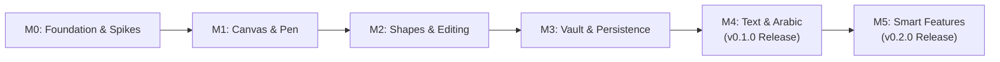

# Mirsam Product Roadmap

This roadmap defines the sequential development milestones for Mirsam. Progress is governed by strict exit criteria and kill/pivot gates.

---

---

## Milestone M0: Foundation, Governance & Technical Spikes
- **Goal**: Establish the repository infrastructure, governance, license enforcement, and execute the 3 time-boxed technical spikes (48h each).
- **Exit Criteria**:
  - [x] Repository renamed to `mirsam`, Apache-2.0 license enforced via `cargo-deny`, governance files active.
  - [x] Research report digested into `docs/research/2026-11-market-and-technical-research.md`.
  - [ ] **Spike 1 (Rasterizer Benchmark)**: Headless benchmark measuring tiny-skia (0.12) vs vello_cpu on 5,000 rectangles, 2,000 strokes, and 500 text boxes at 2560x1440.
  - [ ] **Spike 2 (Arabic Typography & Text Editing)**: Render bilingual phrase `خوارزمية Dijkstra تعمل في O(V log V)` with bundled Aref Ruqaa and Vazirmatn fonts via parley; test editing caret.
  - [ ] **Spike 3 (Day-14 Gate Evaluation)**: Evaluate Gate 1 criteria (1,000 shapes + 100 strokes + editable text at 60 FPS); decide on native Rust vs ADR 0006 Tauri fallback.

---

## Milestone M1: Infinite Canvas & Freehand Pen
- **Goal**: Create the desktop window, establish coordinate mapping, and implement the velocity-smoothed mouse pen.
- **Exit Criteria**:
  - [ ] Native window created via stable `winit` (0.30.x) with software presentation via `softbuffer`.
  - [ ] Canvas coordinate mapping (Screen $\leftrightarrow$ World coordinates) with infinite pan and cursor-centered zoom.
  - [ ] Freehand pen tool with velocity-sensitive stroke width tapering via `freedraw` algorithm.
  - [ ] Continuous mouse drawing maintaining steady 60 FPS ($< 16.6\text{ ms}$ per frame).

---

## Milestone M2: Hand-Drawn Shapes & Direct Manipulation
- **Goal**: Render organic rough geometric shapes and implement element selection, transformation, and undo/redo.
- **Exit Criteria**:
  - [ ] Local converter mapping `roughr::core::OpSet` directly to `tiny_skia::PathBuilder` (no third-party adapter crates).
  - [ ] Rectangle (`R`), Ellipse (`O`), Line (`L`), and Arrow (`A`) tools with deterministic random seeds.
  - [ ] Select tool (`V`) supporting single-click and bounding box drag selection.
  - [ ] Move translation, 8-point corner resize handles, and element deletion (`Delete` / `Backspace`).
  - [ ] Command-pattern Undo (`Ctrl+Z`) and Redo (`Ctrl+Y`) stack (100 operations).

---

## Milestone M3: Persistence & Study Vault
- **Goal**: Save and load boards as versioned JSON files and provide local folder multi-board organization.
- **Exit Criteria**:
  - [ ] Canonical `.mirsam` JSON document serialization with root `"schema_version": 1` and `"format": "mirsam"`.
  - [ ] Atomic save on write (saving to `.tmp` before renaming) to prevent corruption.
  - [ ] Collapsible left sidebar (`Ctrl+B`) displaying folders and boards within an open local OS folder ("Study Vault").
  - [ ] Open (`Ctrl+O`) and Save (`Ctrl+S`) actions operating cleanly on local directories.

---

## Milestone M4: Text Engine, Arabic Typography & v0.1.0 Launch
- **Goal**: Integrate bilingual text rendering, bundle OFL Arabic fonts, provide PNG export, and cut the public v0.1.0 release.
- **Exit Criteria**:
  - [ ] Parley text layout engine integrated into the rendering pipeline.
  - [ ] Bundled OFL-licensed fonts: Aref Ruqaa (headings/display) and Vazirmatn (body notes).
  - [ ] Automatic bidirectional paragraph layout with LTR isolation for math and code tokens.
  - [ ] Double-click on-canvas text editing.
  - [ ] PNG image export (`Ctrl+E`) generating cropped transparent or dark-mode images.
  - [ ] **Public v0.1.0 Release**: Prebuilt Linux (`.tar.gz`, `.AppImage`) and Windows (`.zip`) binaries published on GitHub Releases.
  - [ ] Gate 2 passed: Founder dogfoods Mirsam exclusively for 2 weeks.

---

## Milestone M5: Smart Features & Interoperability (v0.2.0 Release)
- **Goal**: Introduce high-leverage geometric intelligence and external format interoperability.
- **Exit Criteria**:
  - [ ] Bound text auto-grow inside rectangles and ellipses.
  - [ ] Box-to-box pinned raycast connectors that stay attached when shapes move.
  - [ ] Alignment and equal-spacing snapping guides.
  - [ ] Instant cross-board search (`Ctrl+P`) across all boards in the vault.
  - [ ] Numbered lecture frames (16:9 and A4) with slide stepping (`PageDown` / `PageUp`).
  - [ ] Distraction-free Zen mode (`Alt+Z`).
  - [ ] Clipboard image paste (`Ctrl+V`).
  - [ ] JSON Canvas (`.canvas`) export enabling interoperability with Obsidian Canvas.
  - [ ] **v0.2.0 Release** published.

---

## Post-v0.2 Horizon (v0.3.0+)
- **Study Tape**: Active-recall occlusion boxes with click-to-reveal.
- **Inline Math**: Typst / LaTeX mathematical notation rendering.
- **Full Arabic UI**: Mirrored RTL interface layout and localized UI strings.
- **Agent Interoperability**: `SKILL.md` file-watcher enabling external AI agents to generate study boards.
