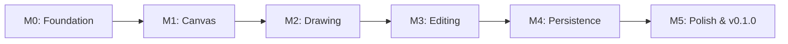

# Lawh Product Roadmap (v0.1.0)

This roadmap outlines the milestones required to build and ship the first public release of Lawh. Each milestone represents a discrete, reviewable layer of functionality with defined exit criteria.

---

---

## Milestone Details

### M0: Foundation & Governance (Current Milestone)
- **Goal**: Establish the repository infrastructure, documentation, ADRs, GitHub configurations, CI pipelines, and minimal Rust workspace skeleton.
- **Exit Criteria**:
  - [x] Repository documentation and ADRs (0001–0005) drafted and published.
  - [x] Pinned GitHub Actions CI pipeline running formatting, clippy, and unit tests.
  - [x] Issue templates, PR template, Dependabot, and labels taxonomy active.
  - [x] Cargo workspace with `lawh-core` crate passing tests in CI.
  - [x] Founder bootstrap Pull Request merged to `main`.

---

### M1: Infinite Canvas & Windowing
- **Goal**: Create the desktop window, establish the 2D coordinate system, and implement smooth cursor-centered panning and zooming.
- **Exit Criteria**:
  - [ ] Desktop window boots via `winit` (0.30.x) with software presentation via `softbuffer`.
  - [ ] Infinite canvas coordinate transforms (World coordinates $\leftrightarrow$ Screen coordinates).
  - [ ] Middle-click drag and `Space + Left-click` drag pan the canvas smoothly.
  - [ ] Mouse wheel zooms the canvas centered on the pointer position (clamped 0.1x to 10.0x).
  - [ ] **Performance Benchmark (Decision 7)**:
    - Headless render benchmark measuring frame render time with 1,000, 5,000, and 10,000 synthetic strokes.
    - Baseline target for review: **Frame render time < 16.6 ms (sustained 60 FPS) at 1,000 strokes** on standard CPU.
    - Produces concrete performance data to evaluate whether GPU acceleration (`vello`) is needed.

---

### M2: Drawing Engine & Hand-Drawn Shapes
- **Goal**: Render organic hand-drawn shapes and smooth freehand pen strokes onto the canvas.
- **Exit Criteria**:
  - [ ] Freehand pen tool with velocity-sensitive stroke smoothing.
  - [ ] Rough geometric shape rendering (Rectangle, Ellipse, Line, Arrow) using the Rough algorithm.
  - [ ] Color palette with 5 dark-mode pastel colors and 3 stroke width settings.
  - [ ] Interactive drawing preview: shapes render responsively during mouse drag.

---

### M3: Direct Manipulation & History
- **Goal**: Select, transform, and arrange shapes with an unlimited undo/redo system.
- **Exit Criteria**:
  - [ ] Single-element click selection and multi-element bounding box drag selection.
  - [ ] Selected element bounding box with 8-point resize handles and move translation.
  - [ ] Element deletion via `Delete` or `Backspace`.
  - [ ] Undo (`Ctrl+Z`) and Redo (`Ctrl+Y` / `Ctrl+Shift+Z`) supporting all canvas mutations up to 100 steps.

---

### M4: Persistence & Export
- **Goal**: Save and load documents in the versioned `.lawh` JSON format and export high-resolution PNG snapshots.
- **Exit Criteria**:
  - [ ] Document serialization and deserialization using the `.lawh` (v1) JSON schema.
  - [ ] Save (`Ctrl+S`) and Open (`Ctrl+O`) dialogs integrated into the desktop application.
  - [ ] Error-tolerant parsing: corrupted or future-versioned attributes degrade gracefully without crashing.
  - [ ] PNG export (`Ctrl+E`) generating a cropped image of all canvas elements with transparent or dark background.

---

### M5: Polish, Packaging & v0.1.0 Release
- **Goal**: Refine UI aesthetics, conduct stress tests, prepare release documentation, and publish Linux binaries.
- **Exit Criteria**:
  - [ ] Clean dark-mode UI toolbar with tool toggles and visual active state.
  - [ ] Keyboard shortcut cheat sheet (`?` key).
  - [ ] Bundled sample diagrams in `samples/` for new users.
  - [ ] 30-minute automated and manual stress tests with 0 panics.
  - [ ] Automated GitHub Release workflow building and publishing standalone Linux binary archives.
  - [ ] Demo GIF recorded and embedded in root `README.md`.

---

## Post-v0.1 Roadmap Preview (Future)
- **v0.2.0**: First-class Arabic and RTL text layout (cosmic-text / HarfBuzz shaping, bidirectional cursor navigation).
- **v0.3.0**: Cross-platform releases (Windows and macOS application bundles).
- **v0.4.0**: Optional GPU rendering backend (`vello`) if stroke benchmarks exceed CPU budget.
- **v0.5.0**: Advanced whiteboard features (SVG export, shape connectors, custom color picker).
